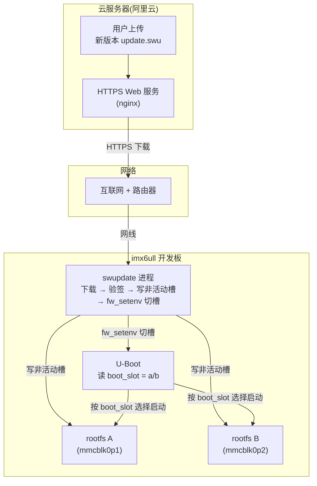

# imx6ull OTA 升级项目

> 基于 **SWUpdate + A/B 双分区** 的嵌入式 Linux 远程升级系统，在 100ask imx6ull pro 开发板上实现并验证。
>

---

## 一、项目介绍

**目标**：为 imx6ull 开发板实现远程系统升级能力（OTA，Over-The-Air）——通过以太网远程下载新系统镜像、自动写入备用分区并切换启动，支持失败回滚，无需物理连接烧录。

**核心方案**：SWUpdate（OTA 升级框架）+ A/B 双分区（冗余升级）+ RSA 签名（防篡改）。

**为什么用 A/B 双分区**（整个项目的灵魂）：
- 系统存两份：A 槽、B 槽
- 升级时**只写"没在用的那个槽"**，正在运行的系统不受影响
- 写完后切换启动槽，下次开机用新系统
- 新系统坏了，切回旧槽就能救回来（不砖）

**当前范围**：升级 rootfs（根文件系统，含内核），分区方案预留了扩展空间。

---

## 二、技术栈

| 组件 | 选型 | 版本 | 作用 |
| --- | --- | --- | --- |
| OTA 框架 | SWUpdate | 2019.11.0 | 下载/校验/写入/切槽 |
| 构建系统 | Buildroot | 2020.02.x | 一键编译 rootfs + 内核 + U-Boot |
| 内核 | Linux | 4.9.88 | 操作系统核心 |
| 引导 | U-Boot |  SDK 内置 | 开机引导 + A/B 切槽 |
| 安全 | RSA 签名 + SHA-256 | openssl | 防篡改、保证升级包可信 |
| 传输 | 以太网 → 局域网/公网 HTTPS | — | 远程下载升级包 |

---

## 三、系统架构



---

## 四、分区方案（SD 卡）

```
RAW   u-boot      （分区表外，offset 1024，Boot ROM 直接加载）
p1    rootfsA 1G  ← A 槽（mmcblk0p1）
p2    rootfsB 1G  ← B 槽（mmcblk0p2）
p3    data    4G  ← 用户数据（升级不动它）
```

**切槽机制**：U-Boot 读环境变量 `boot_slot`（a/b），决定从哪个分区启动。

```bash
boot_slot=a → mmcpart=1 → 从 p1 启动（root=/dev/mmcblk0p1）
boot_slot=b → mmcpart=2 → 从 p2 启动（root=/dev/mmcblk0p2）
```

升级完成后 SWUpdate 调用 `fw_setenv boot_slot <另一个槽>` 完成切槽。

---

## 五、项目进度

| 阶段 | 内容 | 状态 |
| --- | --- | --- |
| 0 | 拉 SDK、编译系统（修 7 个兼容坑） | ✅ 完成 |
| 1 | A/B 双分区 + boot_slot 切槽 | ✅ 完成 |
| 2 | SWUpdate 在线升级闭环 | ✅ 完成 |
| 3 | RSA 签名 + sha256 防篡改 | ✅ 完成 |
| 附加 | eth1 双网口修复 | ✅ 完成 |
| 附加 | 开机自动网络 + sshd 自动启动 | ✅ 完成 |
| 附加 | 版本号管理（1.0.0 → 2.0.0） | ✅ 完成 |

**版本号方案**（用于区分升级前后）：
- 烧录镜像 img = **1.0.0**（升级前）
- 升级包 update.swu = **2.0.0**（升级后）

升级后 `cat /etc/sw-versions` 从 1.0.0 变 2.0.0，升级生效。

---

## 六、硬件与资源

**硬件**： 100ask imx6ull pro 开发板 + SD 卡（≥8G）+ 网线。

**软件源码（本地路径）**：

```bash
SDK=/home/cgh/embedded/100ask_imx6ull-sdk          #  SDK 根目录
内核源码   = $SDK/Linux-4.9.88
Buildroot = $SDK/Buildroot_2020.02.x
交叉工具链 = $SDK/Buildroot_2020.02.x/output/host/bin/arm-buildroot-linux-gnueabihf-gcc
```


---

## 七、目录结构

```
embedded/                              # 本仓库根目录
├── README.md                          # 本文件
├── swupdate/                          # 升级包相关
│   ├── sw-description                 # 升级说明书（写哪个分区、sha256）
│   ├── sw-description.sig             # RSA 签名
│   ├── update.swu                     # 升级包（cpio 归档）
│   ├── rootfs.ext4.gz                 # 压缩的 rootfs 镜像
│   ├── postupdate.sh                  # 升级后切槽脚本
│   └── keys/
│       ├── priv.pem                   # 私钥（⚠ 保密，不入库）
│       └── public.pem                 # 公钥（公开，板子上也有一份）
├── ota-project-files/                 # 项目改造的源文件（可复现）
│   ├── genimage.cfg                   # SD 卡分区/镜像配置
│   ├── mx6ullevk.h                    # U-Boot 配置头（A/B 切槽）
│   ├── defconfig_hook.py / linux.mk   # Buildroot 集成补丁
│   ├── m4-fix.patch                   # 编译兼容补丁
│   ├── eth1-fix/                      # eth1 网口修复（fec_main.c + dts）
│   ├── overlay/                       # rootfs 覆盖层（swupdate.cfg 等）
│   └── overlay-fix/                   # 三件套修复（网络/sshd/reboot）
├── scripts/                           # 调试/验证脚本
├── logs/                              # 构建日志（不入库，可追溯）
└── *.md                               # 文档（README + 各指南，见文档索引）
```

---

## 八、如何复现

### 8.1 快速复现（产物现成，从烧录开始）

编译产物已经在本地，直接从烧录开始：

```bash
# 1. 烧录镜像（在虚拟机里手动执行，注意 of=/dev/sdb 是 SD 卡）
sudo dd if=/home/cgh/embedded/100ask_imx6ull-sdk/Buildroot_2020.02.x/output/images/100ask-imx6ull-pro-512d-systemv-v1.img \
        of=/dev/sdb bs=4M conv=fsync status=progress
sync
```

```bash
# 2. SD 卡插回板子开机，验证从 A 槽启动（串口 115200）
cat /proc/cmdline              # 预期含 root=/dev/mmcblk0p1
cat /etc/sw-versions           # 预期 rootfs 1.0.0
fw_printenv boot_slot          # 预期 boot_slot=a
```

```bash
# 3. 在线升级（电脑上，IP 换成板子实际 IP）
scp swupdate/update.swu root@<板子IP>:/tmp/
ssh root@<板子IP> "swupdate -i /tmp/update.swu -e stable,slotB -f /etc/swupdate/swupdate.cfg -k /etc/swupdate/public.pem"
# 预期看到: Software updated successfully → switch boot_slot a -> b → 自动重启
```

```bash
# 4. 验证升级生效（重启后）
cat /proc/cmdline              # 预期 root=/dev/mmcblk0p2（B 槽）
cat /etc/sw-versions           # 预期 rootfs 2.0.0（版本号变了）
```

### 8.2 完整复现（从编译开始）


升级包的重新打包 + 签名 + 验证，见 **[ota-package-guide.md](ota-package-guide.md)**。

---

## 九、关键踩坑记录（Debug 记录）

| # | 坑 | 根因 | 修复 |
| --- | --- | --- | --- |
| 1 | eth1 网口不通 | fec 驱动只复位一个 PHY，漏复位另一个 | 驱动遍历多个 phy-reset-gpios |
| 2 | 重烧录后修复丢失 | 修复只 scp 部署，没固化进 img | 同步 target/boot + 重打包 img |
| 3 | U-Boot 读文件系统越界 | mkfs 漏 `-N 0` 参数 | 补上 Buildroot 原参数 |
| 4 | 升级报 magic not found | cpio 打包加了 `2>&1` 污染归档 | 去掉重定向，干净打包 |
| 5 | 验签失败 | 板子公钥是旧版，与签名公钥不一致 | 固化正确公钥进 rootfs |
| 6 | 升级后切错槽 | 在 B 槽写 B 槽（应写 A 槽） | 明确"永远写非当前槽"规则 |
| 7 | sshd 启动失败 | 手动 mkfs 没加 fakeroot，owner 全是 uid 1000 | fakeroot 打包 rootfs |
| 8 | 版本号区分不了 | img 和 update.swu 用了同一版本号 | 分开生成：img=1.0.0 / 升级包=2.0.0 |


---

## 十、文档索引

| 文档 | 内容 |
| --- | --- |
| [ota-package-guide.md](ota-package-guide.md) | 升级包打包 + 签名 + 验证手册 |
| [ota-upgrade-guide.md](ota-upgrade-guide.md) | 在线升级操作指南 |
| [flash-sd-card.md](flash-sd-card.md) | SD 卡烧录指南 |

---

## 安全提示

- 升级方向规则：**永远写非当前槽**（A 槽写 slotB，B 槽写 slotA）
- 改内核/dts 后必须重新生成 img 固化，只 scp 部署会在重烧录时丢失
