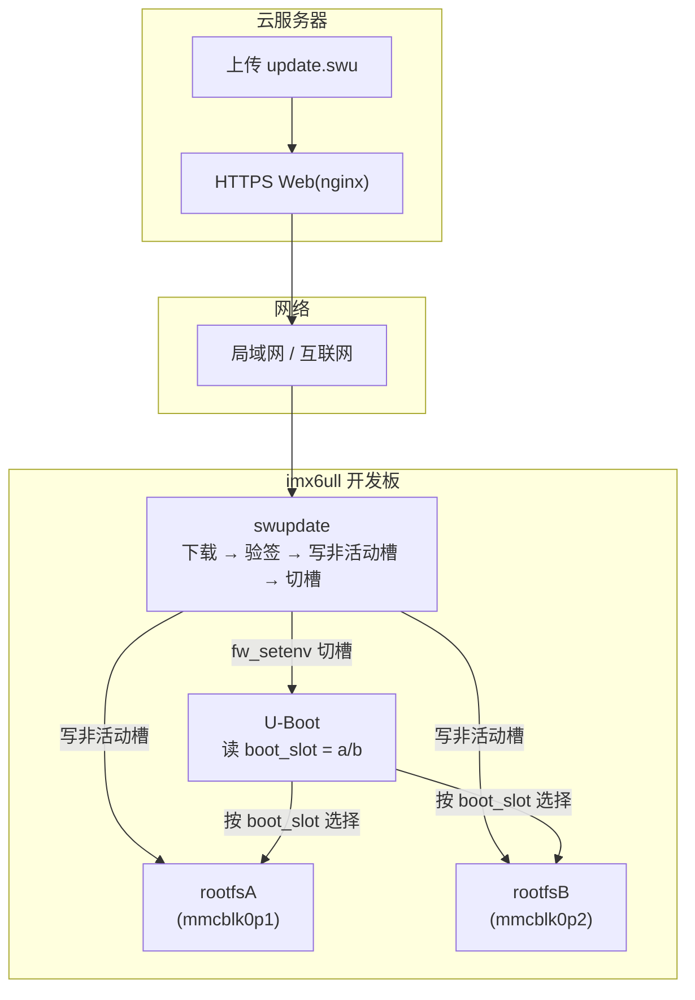

# i.MX6ULL OTA 远程升级系统

> 基于 **SWUpdate + A/B 双分区 + RSA 签名** 的嵌入式 Linux 远程升级系统,在 100ask imx6ull pro 开发板上实现并验证。

---

## 一、项目介绍

**目标**:为 i.MX6ULL 开发板实现远程系统升级(OTA)——通过网线下载新系统、自动写入备用分区、切换启动、失败可回滚,无需物理连接烧录。

**核心方案**:
- **SWUpdate** —— 工业级 OTA 框架,负责下载、验签、写盘、切槽
- **A/B 双分区** —— 系统存两份,升级只写"备用槽",失败天然回滚
- **RSA 签名 + SHA256** —— 升级包防篡改

---

## 二、升级范围(到底升级了什么)

**升级 rootfs(其中包含内核 + 设备树),U-Boot 保持不变。**

- 内核 `zImage` 和设备树 `dtb` 打包在 rootfs 的 `/boot` 目录里
- 所以"升级 rootfs"= 内核 + 设备树 + 根文件系统**一起换**
- U-Boot 独立存放在分区表外,不参与升级

> 换句话说:升级一次,除了引导程序(U-Boot)不动,系统其余部分全部替换。

---

## 三、分区方案(各分区存什么 + 实际占用)

SD 卡分三个分区 + 一个分区表外的 RAW 区:

```
RAW  u-boot      (分区表外, offset 1024, Boot ROM 直接加载)   ← 引导程序,不升级
p1   rootfsA 1G  ← A 槽,完整系统(含 /boot/zImage + dtb + rootfs)
p2   rootfsB 1G  ← B 槽,另一份完整系统
p3   data    4G  ← 用户数据,升级不动
```

**⚠️ 澄清**:U-Boot **不在任何分区里**,它在分区表外的 RAW 区。p3 是 data 分区(存用户数据),和 U-Boot 无关。

**实际占用**:

| 分区 | 分配 | 实际占用 |
|---|---|---|
| rootfsA/B | 1G(1024MB) | rootfs 镜像 **500MB**,约占一半,剩 500MB 预留 |
| data | 4G | 几乎为空 |

- rootfs 解压后 = **500MB**;压缩后 = **50MB**(这就是 update.swu 的大小)

**切槽机制**:U-Boot 读环境变量 `boot_slot`(a/b)决定从哪个分区启动。

```
boot_slot=a → 启动 /dev/mmcblk0p1(A 槽)
boot_slot=b → 启动 /dev/mmcblk0p2(B 槽)
```

升级完成后 SWUpdate 调用脚本改 `boot_slot` 完成切槽。

---

## 四、技术栈

| 组件 | 选型 | 作用 |
|---|---|---|
| 芯片 | NXP i.MX6ULL(Cortex-A7) | 主控 |
| 开发板 |  100ask imx6ull pro | 硬件平台 |
| 构建 | Buildroot 2020.02.x | 一键编译 rootfs + 内核 + U-Boot |
| 内核 | Linux 4.9.88 | 操作系统核心 |
| 引导 | U-Boot | 开机引导 + A/B 切槽 |
| OTA | SWUpdate 2019.11.0 | 下载/校验/写入/切槽 |
| 安全 | RSA 2048 + SHA256(openssl) | 防篡改 |
| 传输 | 以太网(局域网 / 云端 HTTPS) | 升级包下发 |

---

## 五、系统架构



---

## 六、构建基础:为什么用 SDK

从 SDK 开始,而不是从 NXP 官方 SDK 从零搭建,是因为**它是"现成能跑的 BSP"**:

- 内核(Linux 4.9.88)、Buildroot、交叉工具链、U-Boot 全部打包好
- 核心外设(LCD、声卡、USB 等)已调通,一条 `make` 就能出能跑的镜像
- 自己从 NXP 官方 SDK 从零搭,要额外几周做 BSP 移植

**但"能跑"不等于"完全适配你的每块硬件特性"。** 本项目就遇到一个典型案例:100ask 板在 NXP 官方 evk 基础上加了**第二个网口**、并把 PHY 换成需要 GPIO 复位的 LAN8720,而内核 fec 驱动是官方针对"单 PHY"写的,没适配这个改动——所以 eth1 网口起不来。

这是"官方 baseline vs 定制硬件错位"的典型二次开发问题,也正是本项目"改内核驱动修双网口"这个亮点的来源。

SDK 通过 `repo` 从 gitee 拉取(完整命令见"从 0 复现")。

---

## 七、从 0 复现

完整流程(下载 SDK → 配置 → 集成改造 → 编译 → 烧录 → 升级)见 **[docs/reproduce-from-zero.md](docs/reproduce-from-zero.md)**。

核心链路速览:

```bash
# 1. 拉 SDK(内核 + Buildroot + 工具链)
git clone https://e.coding.net/codebug8/repo.git
mkdir -p 100ask_imx6ull-sdk && cd 100ask_imx6ull-sdk
../repo/repo init -u https://gitee.com/weidongshan/manifests.git \
    -b linux-sdk -m imx6ull/100ask_imx6ull_linux4.9.88_release.xml --no-repo-verify
../repo/repo sync -j4

# 2. 配置 Buildroot + 集成 A/B 分区 + 切槽 + 编译
make 100ask_imx6ull_pro_ddr512m_systemV_core_defconfig
make

# 3. 烧录 + 升级(见详细文档)
```

---

## 八、目录结构

```
├── README.md                  # 本文件
├── swupdate/                  # 升级包
│   ├── sw-description         # 升级说明书(写哪个分区、sha256)
│   ├── sw-description.sig     # RSA 签名
│   ├── update.swu             # 升级包(cpio 归档)
│   └── keys/public.pem        # 公钥(板子上也固化一份)
├── ota-project-files/         # 项目改造的源文件(可复现)
│   ├── genimage.cfg           # A/B 分区配置
│   ├── mx6ullevk.h            # U-Boot 切槽配置
│   ├── linux.mk / m4-fix.patch # 编译补丁
│   ├── eth1-fix/              # 双网口修复(内核驱动 + dts)
│   ├── overlay/               # rootfs 覆盖层(SWUpdate 配置等)
│   └── overlay-fix/           # 网络/sshd/reboot 修复
├── docs/                      # 文档
└── scripts/                   # 调试/验证脚本
```

---

## 九、踩坑记录(Debug 记录)

| # | 坑 | 根因 | 修复 |
|---|---|---|---|
| 1 | eth1 网口不通 | fec 驱动只复位一个 PHY,漏复位另一个 | 驱动遍历多个 phy-reset-gpios |
| 2 | 重烧录后修复丢失 | 修复只 scp 部署,没固化进 img | 同步 target/boot + 重打包 img |
| 3 | U-Boot 读文件系统越界 | mkfs 漏 `-N 0` 参数 | 补上 Buildroot 原参数 |
| 4 | 升级报 magic not found | cpio 打包加了 `2>&1` 污染归档 | 去掉重定向 |
| 5 | 验签失败 | 板子公钥是旧版 | 固化正确公钥进 rootfs |
| 6 | 切槽失败 | fw_setenv 多打了空格等号,值被污染 | 正确语法 `fw_setenv boot_slot a` |
| 7 | sshd 启动失败 | 手动 mkfs 没加 fakeroot,owner 全错 | fakeroot 打包 |
| 8 | 版本号区分不了 | img 和升级包用了同一版本号 | 分开生成 img=1.0.0 / 升级包=2.0.0 |

---

## 十、文档索引

| 文档 | 内容 |
|---|---|
| [docs/reproduce-from-zero.md](docs/reproduce-from-zero.md) | **从零完整复现**(下载/配置/集成/编译/烧录/升级) |
| [ota-package-guide.md](ota-package-guide.md) | 升级包打包 + 签名 + 验证 |
| [ota-upgrade-guide.md](ota-upgrade-guide.md) | 在线升级操作 |
| [flash-sd-card.md](flash-sd-card.md) | SD 卡烧录 |

---

## 安全提示

- 升级方向:**永远写非当前槽**(A 槽写 slotB,B 槽写 slotA)
- 改内核/dts 后必须重新生成 img 固化,只 scp 部署会在重烧录时丢失
